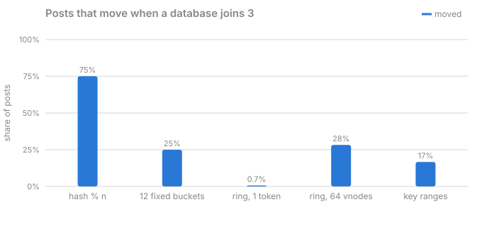
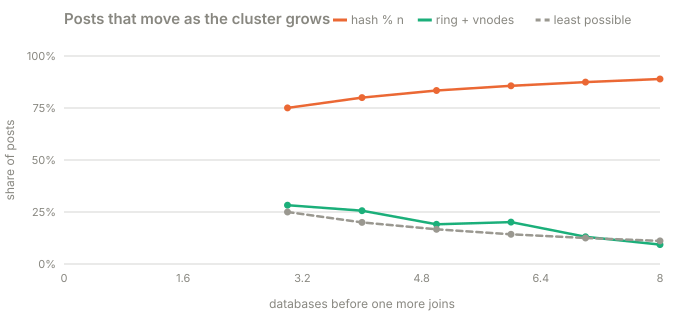

# Part 1 · Why hash % n breaks

**Question:** we have 3 databases and add a 4th. How many comments have to move?

**Answer:** with `hash(post_id) % n`, **75%** of them, shuffled between all four databases.
With buckets, a ring or ranges, only the new database's share moves, and every moved post
goes to the new database.

## The idea, from zero

The simplest way to pick a database is a remainder:

```python
db = databases[crc32(post_id) % 3]
```

`crc32("15003")` is 3,647,724,749. `% 3` is 2, so it lives on DB C. Add a fourth database
and the same post computes `% 4 = 1`: DB B. Nothing about the post changed, only `n`. And
it isn't just this post. A key stays put only if its remainder happens to be the same for
both `n`, which is true for about 1 key in `n + 1`. So adding the 4th database moves about
3 in 4 keys, and the 9th moves about 8 in 9.

The goal of everything that follows: **when DB D joins, move only the data DB D needs.**
The least that can possibly move is DB D's fair share, 1 in 4.

## What the part does

| Step | What happens | Code |
|---|---|---|
| 1 | Take 100,000 post ids | [`POSTS`](../shardbox/experiments.py#L22) |
| 2 | Build each strategy over 3 databases, then the same strategy with a 4th, the way that strategy adds one | [`build`](../shardbox/experiments.py#L29), [`grow`](../shardbox/experiments.py#L43) |
| 3 | Count every post whose owner differs, and check that each moved post went to the new database | [`growth`](../shardbox/experiments.py#L81), [`moves`](../../../packages/jiffy-ring/src/jiffy_ring/placement.py#L51) |
| 4 | Repeat from 3 up to 8 databases | [`sizes`](modulo_breaks.py#L24) |

## Results



| databases | hash % n | 12 fixed buckets | ring, 1 token each | ring, 64 vnodes each | key ranges | least possible |
|---|---|---|---|---|---|---|
| 3 -> 4 | 75.0% | 25.0% | 0.69% | 28.3% | 16.7% | 25.0% |
| 4 -> 5 | 80.0% | 16.7% | 97.3% | 25.6% | 12.5% | 20.0% |
| 5 -> 6 | 83.4% | 16.6% | 0.30% | 19.1% | 10.0% | 16.7% |
| 6 -> 7 | 85.7% | 8.2% | 0.67% | 20.2% | 8.3% | 14.3% |
| 7 -> 8 | 87.4% | 8.2% | 0.58% | 13.1% | 7.1% | 12.5% |
| 8 -> 9 | 88.9% | 8.2% | 0.81% | 9.3% | 6.2% | 11.1% |

And for every strategy except `% n`, every moved post went to the new database: nothing
was reshuffled between the old ones ([results.md](results.md)).



## What it means

- **`% n` gets worse as you grow.** 75% at the 4th database, 89% at the 9th. Each of those
  moves is a row copied between machines while the app is live.
- **Buckets, rings and ranges move the new database's share, more or less.** How close to
  "more or less" depends on the strategy, and that's what the next three parts are about:
  - **12 buckets run out of grain.** With 8 databases, 12 buckets can't be split evenly, so
    the 9th gets one bucket (8.2%) instead of its fair 11%. Redis Cluster uses 16,384 slots
    for exactly this reason ([part 2](../part-2-fixed-buckets)).
  - **One token per database is a lottery.** Sometimes the new database lands in a tiny
    gap (0.3%), sometimes it swallows almost everything (97.3%). Vnodes fix this
    ([part 3](../part-3-the-ring-and-vnodes)).
  - **Ranges split one range in half**, so they move less than the fair share but leave
    the new database underloaded until the next split ([part 4](../part-4-key-ranges)).

## Try this

- Run it, then open `uv run shardbox`, pick **hash % n**, add a database, and watch the
  sample posts table: almost every row turns green.
- Change [`VNODES`](../shardbox/experiments.py#L24) to 256 and rerun: the vnode column
  gets closer to the fair share.

## Files

| File | What's in it |
|---|---|
| [modulo_breaks.py](modulo_breaks.py) | this part |
| [results.md](results.md) | the latest run |
| [test_modulo_breaks.py](test_modulo_breaks.py) | `% n` moves 75%, the others only move to the new database |
