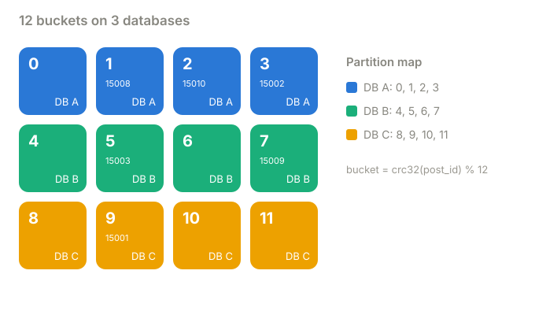
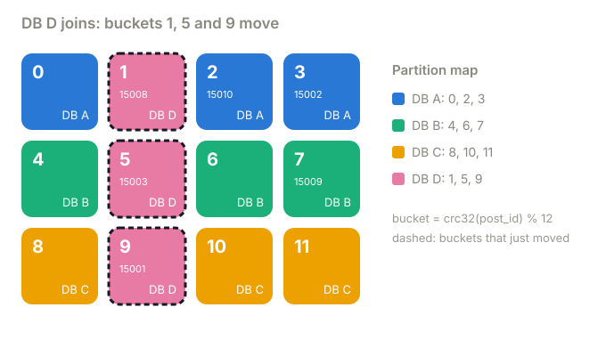

# Part 2 · Fixed buckets and a partition map

**Question:** if `% n` moves everything, what if `n` never changed?

**Answer:** hash every post into one of **12 buckets that never change**, and keep a small
**map** of which database holds each bucket. Adding DB D means moving three whole buckets
and changing three map entries. The post's bucket stays the same forever.

## The idea, from zero

Separate two things that `% n` glued together:

1. **Which partition a post belongs to.** `bucket = crc32(post_id) % 12`. Twelve is fixed,
   whatever number of databases you have.
2. **Which database hosts that partition right now.** A map, owned by the cluster.

```python
PARTITION_MAP = {
    0: "A",
    1: "A",
    2: "A",
    3: "A",
    4: "B",
    5: "B",
    6: "B",
    7: "B",
    8: "C",
    9: "C",
    10: "C",
    11: "C",
}


def find_database(post_id):
    return PARTITION_MAP[crc32(str(post_id).encode()) % 12]
```



A comment for post 15001 arrives. `crc32("15001")` is 929,414,625, and `% 12` is **9**. The
map says bucket 9 is on DB C, so it goes to DB C.

Now DB D joins. We give it a fair share, one bucket from each existing database, and move
just those: buckets **1, 5 and 9**. Bucket 9's rows are copied from DB C to DB D, and one map
entry changes from C to D. The next comment on post 15001 still computes bucket 9; the map
now says DB D.



## What the part does

| Step | What happens | Code |
|---|---|---|
| 1 | Spread 12 buckets over A, B and C in blocks of four | [`FixedBuckets.spread`](../../../packages/jiffy-ring/src/jiffy_ring/placement.py#L100) |
| 2 | Hash a post to its bucket, then look the bucket up in the map | [`bucket`](../../../packages/jiffy-ring/src/jiffy_ring/placement.py#L109) |
| 3 | DB D joins: take one bucket at a time from whichever database holds the most | [`with_node`](../../../packages/jiffy-ring/src/jiffy_ring/placement.py#L115) |
| 4 | Do it for real: write 3,000 comments to real shards, add DB D with a live migration, count rows | [`buckets_run`](../shardbox/experiments.py#L111) → [`change_placement`](../shardbox/cluster.py#L186) |

## Results

| step | value |
|---|---|
| crc32("15001") | 929,414,625 |
| % 12 | bucket 9 |
| partition map, before DB D | bucket 9 is on DB C |
| partition map, after DB D | bucket 9 is on DB D |

| database | buckets before | buckets after | rows before | rows after | share after |
|---|---|---|---|---|---|
| DB A | 0, 1, 2, 3 | 0, 2, 3 | 980 | 700 | 23.3% |
| DB B | 4, 5, 6, 7 | 4, 6, 7 | 1,006 | 773 | 25.8% |
| DB C | 8, 9, 10, 11 | 8, 10, 11 | 1,014 | 747 | 24.9% |
| DB D | none | 1, 5, 9 | 0 | 780 | 26.0% |

780 rows copied (A to D: 280, B to D: 233, C to D: 267), every one to DB D
([results.md](results.md)).

## What it means

- **The hash never changes; only the map does.** That's why nothing reshuffles between A,
  B and C. A post's bucket is its identity, and moving data is moving whole buckets.
- **You choose what moves.** Here we took one bucket from each. A real cluster would pick
  by load: move the hot bucket, or keep a tenant's buckets together.
- **The map is the critical piece of state.** Every router needs the same map. Real
  systems keep it in a coordinator (etcd, ZooKeeper, a metadata database) with a version
  number. Routers cache it and refresh when the version moves. A router with a stale map
  must not be able to write to the old owner, which is what fencing epochs are for (see
  [challenge 01](../../01-zombie-worker)).
- **The bucket count is your finest grain.** 12 buckets over 8 databases can't be even.
  Pick far more buckets than you'll ever have databases.

**Who does this:** Redis Cluster (16,384 hash slots, moved between nodes with
`CLUSTER SETSLOT`), Elasticsearch (a fixed number of primary shards per index, placed on
nodes), Kafka (a fixed number of partitions per topic, assigned to brokers).

## A note on crashes

The map tells you where data *belongs*. It doesn't make a copy. If DB C dies and bucket 9
only ever lived there, changing the map to DB A just points requests at an empty bucket.
Real clusters keep a replica of every bucket on another machine and promote it; part 5
measures what happens with and without one.

## Try this

- In `uv run shardbox`, pick **Fixed buckets** and add a database: three buckets turn pink
  and the partition map updates. Add another, and see how few buckets each one gets.
- Change [`BUCKETS`](../shardbox/experiments.py#L23) to 64 and rerun part 1: the bucket
  column tracks the fair share much more closely.

## Files

| File | What's in it |
|---|---|
| [fixed_buckets.py](fixed_buckets.py) | this part |
| [results.md](results.md) | the latest run |
| [test_fixed_buckets.py](test_fixed_buckets.py) | D takes 1, 5 and 9, and only D receives rows |
