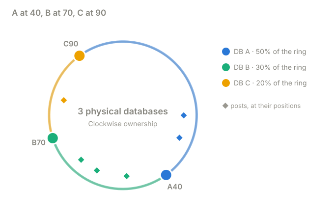
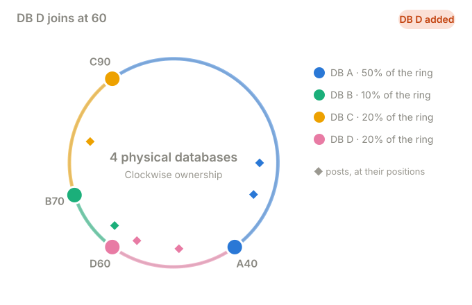
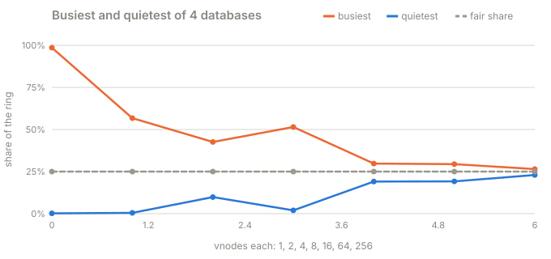
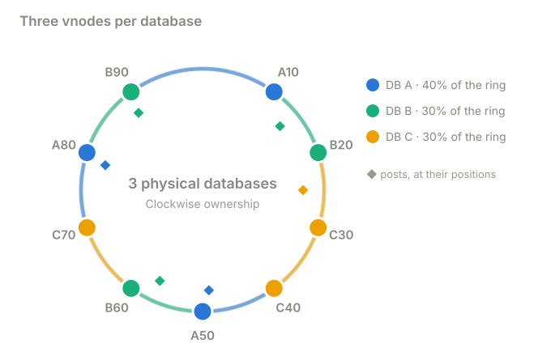
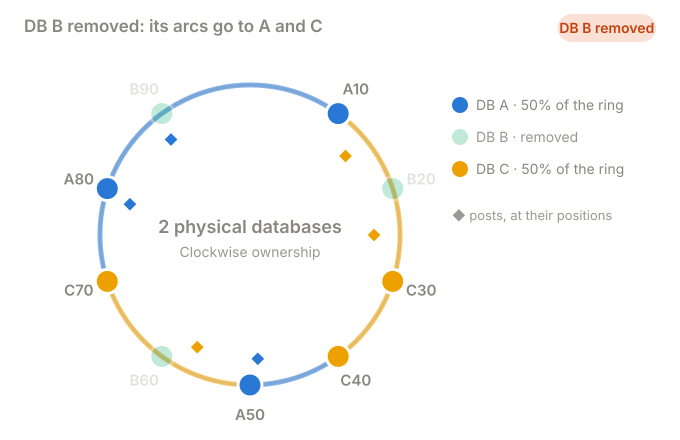

# Part 3 · The ring and virtual nodes

**Question:** can the hash alone say who owns a key, with no map to keep in sync, and move
only what it has to when a database comes or goes?

**Answer:** yes. Put the databases on a circle of hash positions. A key belongs to the first
database **clockwise** from it. Adding a database takes only the arc just before it.
Giving every database **many** tokens (virtual nodes, or vnodes) makes the shares even and
spreads a leaving database's data over several others.

## The idea, from zero

Imagine a clock face numbered 0 to 99. Hash a post id onto it (`crc32(post_id) % 100`) and
put each database at a fixed number on the same face: DB A at 40, DB B at 70, DB C at 90.

The rule: **a key belongs to the first database you meet walking clockwise from it.**

| database | owns positions | share |
|---|---|---|
| DB A at 40 | 91 to 99 and 0 to 40 (it wraps past 99) | 50% |
| DB B at 70 | 41 to 70 | 30% |
| DB C at 90 | 71 to 90 | 20% |

A comment for post 15003 arrives. `crc32("15003") % 100` is **49**. The next database
clockwise from 49 is DB B at 70, so it is stored on DB B. Every API server can work this out
alone from the list of databases and their positions, with no partition map to fetch.

**DB D joins at 60.** It takes over positions 41 to 60, the arc just before it, and nothing
else:

| post | position | before | after |
|---|---|---|---|
| 15001 | 25 | DB A | DB A |
| 15002 | 79 | DB C | DB C |
| 15003 | 49 | DB B | **DB D** |
| 15008 | 57 | DB B | **DB D** |
| 15009 | 31 | DB A | DB A |
| 15010 | 62 | DB B | DB B |

A and C give up nothing. A post at position 65 still belongs to DB B (the next token
clockwise is 70).

The ring only *computes* ownership. Rows still have to be copied from B to D (part 5).

## The problem with one token each: it's a lottery

The ring above has three tokens, and DB A owns 50% of it while DB C owns 20%. With real hash
positions it's worse, because tokens land wherever the hash puts them:

| vnodes each | busiest DB | quietest DB | spread (stdev) | DBs giving data to a 5th | biggest single handoff |
|---|---|---|---|---|---|
| 1 | 98.6% | 0.20% | 42.5% | 1 | 61.5% |
| 2 | 56.7% | 0.49% | 24.7% | 1 | 19.5% |
| 4 | 42.6% | 9.9% | 12.3% | 2 | 20.5% |
| 8 | 51.5% | 2.0% | 22.1% | 2 | 20.2% |
| 16 | 29.8% | 19.1% | 4.2% | 4 | 4.5% |
| 64 | 29.4% | 19.2% | 4.1% | 4 | 1.1% |
| 256 | 26.5% | 23.0% | 1.3% | 4 | 0.32% |

With one token, one of four databases owned 98.6% of the keys. The fix is to give each
physical database **many** positions on the ring, so its share is the sum of many small,
scattered arcs, and the luck averages out.

## Virtual nodes

Each database appears on the ring several times. These are *logical* positions, not more
machines: three PostgreSQL servers, nine tokens.

| database | its tokens |
|---|---|
| DB A | 10, 50, 80 |
| DB B | 20, 60, 90 |
| DB C | 30, 40, 70 |

A token owns the arc from just after the previous token up to itself. Token B60 owns 51 to
60, and it lives on DB B. A comment for post 15008 hashes to 57, the next token clockwise is
60, so it goes to DB B.

**Now remove DB B on purpose.** Its three arcs each go to the next token clockwise:

| post | position | before | after |
|---|---|---|---|
| 15001 | 25 | DB C | DB C |
| 15002 | 79 | DB A | DB A |
| 15003 | 49 | DB A | DB A |
| 15008 | 57 | DB B | **DB C** (B60 falls to C70) |
| 15012 | 14 | DB B | **DB C** (B20 falls to C30) |
| 15055 | 89 | DB B | **DB A** (B90 wraps to A10) |

DB B's data went to **two** databases, not one. That's the other half of the benefit:
when a node leaves (or joins), every neighbour shares the work instead of one machine taking
all of it and doubling its load.

## What the part does

| Step | What happens | Code |
|---|---|---|
| 1 | Hash a key onto the ring | [`position`](../../../packages/jiffy-ring/src/jiffy_ring/placement.py#L31) |
| 2 | Find the first token at or after it, wrapping | [`owner_of_position`](../../../packages/jiffy-ring/src/jiffy_ring/placement.py#L188), [`token_at`](../../../packages/jiffy-ring/src/jiffy_ring/placement.py#L192) |
| 3 | Give each database many tokens, hashed from `"db#i"` so every router computes the same ring | [`Ring.build`](../../../packages/jiffy-ring/src/jiffy_ring/placement.py#L175) |
| 4 | List every arc, and each database's share | [`arcs`](../../../packages/jiffy-ring/src/jiffy_ring/placement.py#L214), [`ownership`](../../../packages/jiffy-ring/src/jiffy_ring/placement.py#L222) |
| 5 | Which arcs does a new database take, and from whom? | [`taken_by`](../../../packages/jiffy-ring/src/jiffy_ring/placement.py#L238), [`changed_arcs`](../../../packages/jiffy-ring/src/jiffy_ring/placement.py#L248) |
| 6 | Run the lessons for real, with one comment per post in real shards | [`lesson`](../shardbox/experiments.py#L155), [`vnode_lesson`](../shardbox/experiments.py#L194) |
| 7 | Measure how even rings of 1 to 256 vnodes are | [`balance`](../shardbox/experiments.py#L221) |

## What it means

- **The ring needs no map.** Every router computes the same owner from the member list.
  (It still needs the member list to agree: part 7.)
- **A new database takes only the arc before its tokens.** In the lesson, 2 of 6 posts
  moved and both went to the new database. In part 1, a ring with 64 vnodes moved 28.3% of
  keys when the 4th database joined (fair share: 25%).
- **Many tokens fix the lottery.** The busiest of four databases fell from 98.6% to 26.5%
  of the ring, the fair 25% being the target. 16 tokens each is already decent.
- **Vnodes spread the load of a leaving database**, and let a bigger machine take more
  tokens than a smaller one.
- **Vnodes cost metadata and migrations.** More tokens means a bigger ring to ship around,
  and a join becomes many small range copies instead of one big one.
- **Vnodes are not replicas.** DB B's three tokens sit on the *same* machine. If it dies they
  all go together. Replicas must be on *different* physical databases: that's what
  [`preference`](../../../packages/jiffy-ring/src/jiffy_ring/placement.py#L200) does, taking
  the next *different* databases clockwise.
- **Balanced keys is not balanced traffic.** One post with 200,000 writes a second still goes
  to one database: [part 6](../part-6-one-viral-post).

**Who does this:** Amazon Dynamo, Apache Cassandra and ScyllaDB (a token ring, with 16 to 256
vnodes per node), Riak, and memcached clients using ketama.

## Try this

- In `uv run shardbox`, pick **Ring + vnodes**, press **Remove** on DB B, and watch the
  sample table: three posts change owner and the ring shows B's faded tokens. Press
  **Restore DB B** to put it back.
- Pick **Hash ring**, add a database at position 60 (the field next to the button), then try
  position 41: it takes a smaller arc.
- Tick **real 2³² ring** and add databases: with one hashed token each, the shares are
  uneven. Switch to vnodes.

## Files

| File | What's in it |
|---|---|
| [ring_and_vnodes.py](ring_and_vnodes.py) | this part |
| [results.md](results.md) | the latest run |
| [test_ring_and_vnodes.py](test_ring_and_vnodes.py) | the lesson numbers, and more vnodes evening out the ring |
