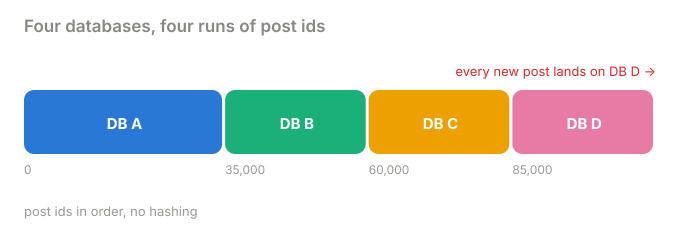
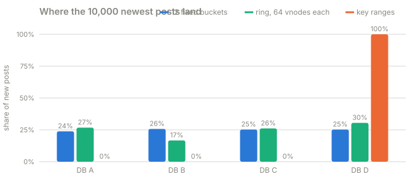

# Part 4 · Key ranges

**Question:** hashing spreads keys evenly, but it also scatters neighbours. What if you
don't hash at all?

**Answer:** each database owns a **contiguous run of keys**. Neighbouring posts stay on one
database, so a range scan asks 1 database instead of every one. The price: new keys pile
onto the last range, and a hot range has to be split.

## The idea, from zero

Instead of hashing, sort. Post ids already come in order (each new post gets the next
number), so give each database a run of them:

| database | owns post ids |
|---|---|
| DB A | 0 to 34,999 |
| DB B | 35,000 to 59,999 |
| DB C | 60,000 to 84,999 |
| DB D | 85,000 and up |

To find the owner, look up the id in a sorted list of range starts: the range whose start is
the largest one at or below the id. No hash.

That's the opposite trade from hashing:

| | hashed (buckets, ring) | ranges |
|---|---|---|
| neighbouring keys | scattered across databases | together on one |
| "comments of posts 15,000 to 15,999" | asks every database | asks one |
| where new posts go | spread evenly | **all to the last range** |
| adding a database | takes a share from everyone | splits one range in two |

## What the part does

| Step | What happens | Code |
|---|---|---|
| 1 | Cut the id space into equal runs, one per database | [`Ranges.even`](../../../packages/jiffy-ring/src/jiffy_ring/placement.py#L283) |
| 2 | Scan 1,000 neighbouring posts under each strategy and count the databases asked | [`scans`](../shardbox/experiments.py#L250) |
| 3 | Write the 10,000 newest posts under each strategy and count where they land | [`hotspots`](../shardbox/experiments.py#L266) |
| 4 | Add a database: find the busiest range and split it at its median key | [`Ranges.with_node`](../../../packages/jiffy-ring/src/jiffy_ring/placement.py#L305), [`split`](../shardbox/experiments.py#L282) |

## Results

**A range scan.** Read posts 15,000 to 15,999:

| strategy | databases asked (of 4) |
|---|---|
| 12 fixed buckets | 4 |
| ring, 64 vnodes each | 4 |
| key ranges | **1** |

**Where the 10,000 newest posts go** (new posts get the next id):

| strategy | DB A | DB B | DB C | DB D |
|---|---|---|---|---|
| 12 fixed buckets | 23.8% | 25.7% | 25.2% | 25.2% |
| ring, 64 vnodes each | 26.7% | 16.7% | 26.1% | 30.5% |
| key ranges | 0.0% | 0.0% | 0.0% | **100.0%** |

**DB E joins:** the busiest range splits at its median.

| | ranges (first post id: owner) |
|---|---|
| before | 0: A, 35,000: B, 60,000: C, 85,000: D |
| after | 0: A, 22,500: E, 35,000: B, 60,000: C, 85,000: D |

Split at 22,500. 12.5% of posts moved, all from DB A (12,500 posts) to DB E ([results.md](results.md)).

## What it means

- **Ranges make scans cheap.** "Everything from this tenant", "the last hour of events",
  "all rows between two keys" touch one or two databases. That's why databases built around
  ordered scans use them.
- **Ranges make the newest data a hotspot.** With auto-increment ids or timestamps as the
  key, every write goes to the last range: one database takes 100% of the new writes while
  the others sit idle. The usual fixes are to put a hashed prefix in front of the key (which
  gives up the scan again) or to split the hot range as fast as it grows.
- **Ranges adapt by splitting.** A range that grows too big or too busy is cut at its median
  and one half moves to a new database. Nothing moves between the others.
- **Ranges are not striping.** In part 6 a hot post is spread by adding a suffix to its key.
  A range placement orders by the id itself, so a suffix would only move the key. The
  cluster refuses to stripe on ranges.

**Who does this:** Google Bigtable and Spanner (tablets), Apache HBase (regions), CockroachDB
(ranges of about 512 MB that split and merge automatically), TiKV, MongoDB ranged sharding,
and Vitess range vindexes.

## Try this

- In `uv run shardbox`, pick **Key ranges** and add a database: a range splits in half. Add a
  few more and watch the biggest ranges split first.
- Press **Write 200 comments**: they spread over the range of random ids you picked. Now send
  a request for post 109,999 repeatedly: it always hits the last database.

## Files

| File | What's in it |
|---|---|
| [key_ranges.py](key_ranges.py) | this part |
| [results.md](results.md) | the latest run |
| [test_key_ranges.py](test_key_ranges.py) | scans touch 1 database, new posts all land on one, a split moves only from the donor |
