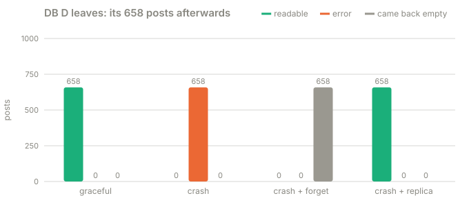

# Part 5 · Moving data safely

**Question:** the placement says DB D should own a range. How do the rows get there while
people keep writing, and what happens if a database just dies instead?

**Answer:** move data in steps (capture, copy, catch up, fence, switch, clean up) so that
no acknowledged write is lost or doubled. And remember: a new owner on paper is not a copy
on disk. A crash with no replica loses data, however clever the placement.

## The idea, from zero

The placement (buckets, ring or ranges) is only arithmetic. It says where a post *should*
live. It does not move a single byte. Moving the bytes is a separate job, and the dangerous
part is that **writes don't stop while you do it**:

- Copy a range from DB B to DB D, ignore new writes, switch: every comment written during the
  copy is missing on DB D. Silent data loss.
- Switch first and copy later: for a while, reads on DB D find nothing.
- Let both databases take writes for the same range: now they disagree.

The safe sequence, which the cluster runs for every placement change:

| Step | What happens | Why |
|---|---|---|
| 1 Provision | open the new database; it serves nothing yet | nothing can reach it by accident |
| 2 Capture | from now on, log every write to a key whose owner is changing | so nothing written mid-copy is lost |
| 3 Copy | copy every row whose owner is changing, while writes keep flowing | the bulk of the work, with no pause |
| 4a Catch up | replay the log on the new owner, while writes keep flowing | shrink the backlog before the pause |
| 4b Fence | briefly hold writes to the moving keys, let in-flight ones finish, replay the last few | the only pause, and only for the moving keys |
| 5 Switch | publish the new placement and lift the fence | now the new owner serves it |
| 6 Clean up | delete the moved rows from the old owners | they no longer own them |

Writes to every other key never wait.

## What the part does

| Step | What happens | Code |
|---|---|---|
| 1 | Three databases take writes from 8 threads. After two seconds DB D joins, under each strategy | [`live_migration`](../shardbox/experiments.py#L308) |
| 2 | The cluster runs the steps above | [`change_placement`](../shardbox/cluster.py#L186) |
| 3 | A write whose key is moving is captured, and held while the fence is up | [`write`](../shardbox/cluster.py#L95) |
| 4 | Afterwards every acknowledged comment is read back through the router, exactly once | [`found`, `lost`](../shardbox/experiments.py#L359) |
| 5 | DB D leaves four ways | [`leaving`](../shardbox/experiments.py#L381) |

## Results

**A. DB D joins while 8 writers keep writing** (4 seconds per run):

| strategy | writes acked | read back once | lost | duplicated | rows copied | writes during the move | captured and replayed | fence | slowest write |
|---|---|---|---|---|---|---|---|---|---|
| 12 fixed buckets | 11,570 | 11,570 | 0 | 0 | 2,120 | 960 | 183 | 2.3 ms | 531 ms |
| ring, 64 vnodes each | 9,762 | 9,762 | 0 | 0 | 2,185 | 766 | 162 | 3.4 ms | 576 ms |
| key ranges | 14,506 | 14,506 | 0 | 0 | 1,345 | 745 | 59 | 0.2 ms | 960 ms |

Hundreds of writes landed during each move (960, 766 and 745). The ones that hit a moving
key (183, 162 and 59) were captured and replayed, and **none were lost or doubled**. Writes to keys that were not
moving never waited. (The slowest write is the machine's own noise: eight Python threads
and a copy competing for one disk. The fence itself lasted milliseconds.)

**B. DB D leaves.** What happens to the 658 posts it held:

| how DB D left | still readable | error (unavailable) | came back empty |
|---|---|---|---|
| graceful removal | 658 | 0 | 0 |
| crash | 0 | 658 | 0 |
| crash, then dropped from the ring | 0 | 0 | 658 |
| crash with 1 replica, then fail-over | 658 | 0 | 0 |

Read the third row twice. After the crash someone "fixed" the ring by dropping DB D. The
router now computes a new owner for those 658 posts, sends the read there, and gets back an
**empty answer, not an error**. Nothing alerts, and the comments are simply gone for readers.

## What it means

- **Graceful removal** moves the data first, then retires the database. Nobody notices.
- **A crash with no copy loses the data**, however you rearrange the ring. Hashing and
  placement only tell you where data *belongs*. Replication and backups are what let you
  *recover* it.
- **Rerouting without recovering is the worst outcome.** An error is loud. An empty answer is
  silent. Anything that changes ownership after a crash must restore the data first.
- **Replicas go on different physical machines.** `Ring.preference` takes the next *different*
  databases clockwise, skipping a database's other vnodes, because vnodes on the same machine
  die together. With one replica, every comment already lives on the next database, so
  fail-over is only a switch ([`fail_over`](../shardbox/cluster.py#L177)).
- **Asynchronous replicas can be behind.** Anything acknowledged but not yet replicated when
  the primary dies is lost. Replication settings decide how big that window is. This lab
  writes the replica before acknowledging, so its window is zero; real systems often don't.
- **Replicas and migration are kept apart here.** Moving data *and* keeping the replica count
  in step while it moves is the next level, and the cluster refuses to try it.

**A subtle one: deletes.** Replaying a captured *delete* as an ordinary insert would bring a
deleted comment back, so change order matters. This lab only inserts; a real mover replays
inserts, updates and deletes in commit order.

## Try this

- In `uv run shardbox`, pick **Ring + vnodes**, press **Write 200 comments** a few times,
  then **Remove** a database: watch "rows copied", "captured and replayed" and the fence
  time in the last-change panel.
- Press **Crash** on a database, then read a post it owned: an error. Now press **Forget**,
  and read it again: **0 comments, no error**. That's row three of the table.

## Files

| File | What's in it |
|---|---|
| [moving_data.py](moving_data.py) | this part |
| [results.md](results.md) | the latest run |
| [test_moving_data.py](test_moving_data.py) | a live move keeps every acknowledged write |
