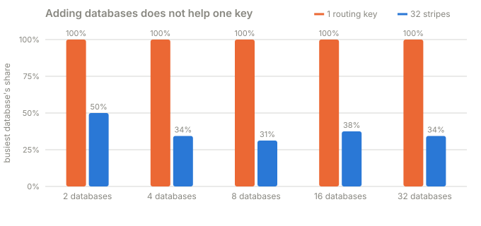

# Part 6 · One viral post

**Question:** one post receives 200,000 comments a second. We have plenty of databases and
vnodes. Where do those writes go?

**Answer:** all of them to **one** database. Adding databases, adding vnodes, switching
strategy: none of it helps, because the same post id always hashes to the same place. The fix
is to split the *key*: give that one hot post several routing keys (stripes) that hash
to different places.

## The idea, from zero

Every strategy in this challenge turns a key into an owner with arithmetic, and arithmetic is
deterministic. `crc32("15001")` is the same number today and tomorrow, so post 15001 has
exactly one owner at any moment. Balanced hashing spreads **different keys** evenly. It
cannot spread **one** key, because one key is one hash, and one hash is one database.



| databases | busiest DB's share, 1 key | databases written, 1 key | busiest DB's share, 32 stripes | databases written, 32 stripes |
|---|---|---|---|---|
| 2 | 100.0% | 1 | 50.0% | 2 |
| 4 | 100.0% | 1 | 34.4% | 4 |
| 8 | 100.0% | 1 | 31.2% | 7 |
| 16 | 100.0% | 1 | 37.5% | 6 |
| 32 | 100.0% | 1 | 34.4% | 7 |

(200,000 comments on post 15001. With one key, 32 databases is exactly as bad as 2.)

## The fix: stripes

Make the routing key longer than the post id. Instead of hashing `15001`, hash
`15001:0`, `15001:1`, ... `15001:31`, picking the stripe per comment (here, comment id modulo
the stripe count). Different strings hash to different positions, so the comments spread
over up to 32 databases.

```python
route = f"{post_id}:{comment_id % stripes}"  # was: str(post_id)
```

A read has to undo it: ask **every database that holds a stripe**, then merge by comment id
(scatter, gather). In the cluster that is [`read`](../shardbox/cluster.py#L142).

**Real shards, 3,000 comments on one post, 4 databases:**

| stripes | comments per database | read back | in order | duplicates | databases asked |
|---|---|---|---|---|---|
| 1 | db0: 3,000, db1: 0, db2: 0, db3: 0 | 3,000 | yes | 0 | 1 |
| 8 | db0: 1,500, db1: 1,500, db2: 0, db3: 0 | 3,000 | yes | 0 | 2 |
| 32 | db0: 1,031, db1: 751, db2: 468, db3: 750 | 3,000 | yes | 0 | 4 |

## How many stripes? More than you'd think

Eight databases, 200,000 writes, fair share 12.5%:


| stripes | busiest DB's share | databases written | databases a read must ask |
|---|---|---|---|
| 1 | 100.0% | 1 | 1 |
| 2 | 100.0% | 1 | 1 |
| 4 | 100.0% | 1 | 1 |
| 8 | 50.0% | 2 | 2 |
| 16 | 25.0% | 5 | 5 |
| 32 | 31.2% | 7 | 7 |
| 64 | 28.1% | 8 | 8 |
| 128 | 25.0% | 8 | 8 |

Notice the first rows. **8 stripes on 8 databases reached only 2.** Strings that differ in one
trailing character produce CRC32 values that sit in clumps on the ring, so several stripes
land on the same database. It takes a few times more stripes than databases before every one
is used (64 stripes reached all 8). The remaining gap to 12.5% is the ring's own unevenness
with 64 vnodes each, which part 3 measured. A stronger hash function (murmur, xxhash, SHA)
mixes near-identical keys better; CRC32 is used here because it makes the lesson's numbers
reproducible by hand.

## What it costs

- **Every read of that post asks several databases.** 32 stripes on 4 databases: all 4.
  Reads of *other* posts are untouched, which is why you stripe only the hot ones.
- **Merging and ordering.** Comments from several stripes must be merged by id or time.
  Counters ("12,431 comments") must be summed across stripes, or kept separately.
- **You must know which posts are hot.** Systems either detect it (a hot-key counter) and
  stripe automatically, or let the application decide. The cluster here has an explicit
  `stripe(post_id, ways)`.
- **Old comments stay where they were.** Stripes apply to new writes; `owners_of` also asks
  the original owner.
- **Ranges can't be striped by suffix.** They order by the id itself.
- **Caching helps the read side.** Viral posts are read far more than written; a cache absorbs
  most reads, so striping is about the write path.

**Who does this:** key salting in DynamoDB (write sharding with a random suffix), partition-key
salting in Cassandra and Kafka, and distributed counters in Firestore (one counter split over
many documents).

## What the part does

| Step | What happens | Code |
|---|---|---|
| 1 | Route 200,000 comments on one post, by the post id or by `post:stripe` | [`hot_load`](../shardbox/experiments.py#L453) |
| 2 | Repeat for 2 to 32 databases | [`hot_scale`](../shardbox/experiments.py#L469) |
| 3 | Repeat for 1 to 128 stripes on 8 databases | [`hot_stripes`](../shardbox/experiments.py#L474) |
| 4 | Do it with real shards and read it back | [`hot_real`](../shardbox/experiments.py#L490), [`stripe`](../shardbox/cluster.py#L77), [`read`](../shardbox/cluster.py#L142) |

## Try this

- In `uv run shardbox`, find the **One viral post** card. Send the comments with 1 stripe: one
  database takes all of them. Now try 32.
- Switch to **Fixed buckets** and try again. Then **Key ranges**: it can't be striped.

## Files

| File | What's in it |
|---|---|
| [viral_post.py](viral_post.py) | this part |
| [results.md](results.md) | the latest run |
| [test_viral_post.py](test_viral_post.py) | more databases do not help one key; stripes do; a striped post reads back complete and in order |
