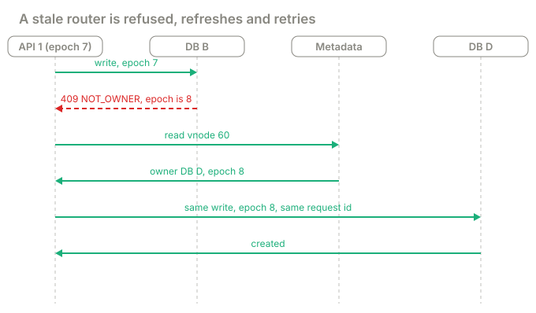
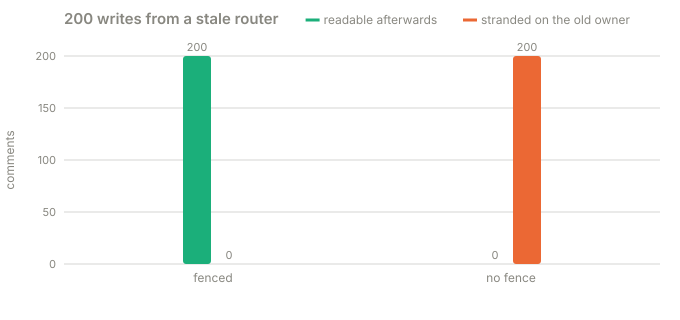
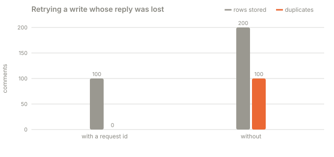

# Part 7 · Stale routers and epochs

**Question:** vnode 60 moves from DB B to DB D. API server 1 still thinks it is on DB B.
API server 2 knows it moved. What happens to a write that API 1 sends?

**Answer:** it depends entirely on whether DB B **checks**. If DB B enforces ownership, it
refuses, API 1 refreshes its map and retries on DB D, and nothing is lost. If DB B trusts the
caller, it accepts the write, and that comment is gone for every reader. The check is an
**epoch**.

## The idea, from zero

By part 6 we have three pieces of knowledge, and they live in different places:

| Piece | Says | Lives in |
|---|---|---|
| The hash ring | which **partition** (vnode) a post belongs to | the code, computed anywhere |
| The partition map | which **database** owns that partition right now | one authoritative service (etcd, a metadata table) |
| The database's own door | whether it **may** accept this write at this moment | the database's gateway |

The authoritative record for vnode 60 looks like this:

```json
{ "vnode": 60, "range": [51, 60], "primary": "db-b", "replicas": ["db-c"], "epoch": 7, "state": "ACTIVE" }
```

The **epoch** is the ownership generation. Every move bumps it: 7 becomes 8. It is not the
number of databases.

Asking the metadata service on every request would make it the bottleneck, so each API server
**caches** the map. A cache can be stale, and that is the whole problem.



1. A client posts a comment. API 1 hashes the post (position 57), finds vnode 60, and its
   cache says "DB B, epoch 7".
2. API 1 sends the write to DB B's gateway, tagged `epoch 7`.
3. DB B's gateway checks the authoritative state: vnode 60 is now DB D at epoch 8. It answers
   `409 NOT_OWNER, current epoch 8`.
4. API 1 reads the metadata, caches "DB D, epoch 8", and retries **the same operation**.
5. DB D accepts it.

One refusal teaches the router. All the later writes from API 1 go straight to DB D.

## Why the check must live at the database

The check at the router is useless: the router is the one with the stale map. The check at
the database only works if it can't race the move. If the gateway looked at its ownership
variable, a migration flipped it, and *then* the write committed, the write would land on the
old owner after the cutover. So here the check and the commit happen under the same lock that
guards the move ([`Gateway.insert`](../shardbox/routing.py#L93)). In a real system that is a
fencing token or a lease, enforced by the database itself (see
[challenge 01](../../01-zombie-worker), which fences a stalled worker the same way).

## What the part does

| Step | What happens | Code |
|---|---|---|
| 1 | Four real databases, each behind a gateway, on the vnode ring from part 3 | [`_lab`](../shardbox/experiments.py) |
| 2 | The metadata record for each vnode starts at epoch 7 | [`Metadata`](../shardbox/routing.py#L55), [`FIRST_EPOCH`](../shardbox/routing.py#L30) |
| 3 | API 1 caches the map, then vnode 60 moves B to D: copy the rows, then flip the owner and the epoch | [`move_partition`](../shardbox/routing.py#L185), [`Metadata.move`](../shardbox/routing.py#L74) |
| 4 | API 1 writes 200 comments with its old map | [`stale_router`](../shardbox/experiments.py#L549), [`Router.write`](../shardbox/routing.py#L144) |
| 5 | The gateway refuses a wrong owner or a wrong epoch | [`Gateway.insert`](../shardbox/routing.py#L93) |
| 6 | The router refreshes and retries on `NOT_OWNER` | [`except NotOwner`](../shardbox/routing.py#L166) |

## Results

**A. Vnode 60 moves from DB B to DB D (epoch 7 to 8); API 1 still has the old map, then writes 200 comments:**



| | DB B checks the epoch (fenced) | DB B trusts the caller (no fence) |
|---|---|---|
| writes sent by the stale API 1 | 200 | 200 |
| refused with NOT_OWNER | 1 | 0 |
| metadata reads the stale API paid for | 1 | 0 |
| succeeded on the retry, on DB D | 1 | 0 |
| readable afterwards from the current owner | 200 of 200 | **0 of 200** |
| rows stranded on the old owner | 0 | **200** |

Without the check, nothing complains. Every write returns "created". DB B really did store
them. They are just on the wrong database, so every reader who asks the current owner finds
nothing. This is silent data loss, and it starts the moment the move finishes and lasts until
the stale caches expire.

## The second half of safe retries: idempotency

API 1's retry above was safe only because the **same operation** was resent. Consider
another common failure: DB D commits the comment but the reply is lost (a timeout). API 1
doesn't know whether it worked. If it retries as a brand new comment, there are now two.

The fix is a **request id** carried by every retry, stored under a unique constraint
([`put_once`](../shardbox/store.py#L79)): the retry finds its own row and does nothing.

**B. 100 writes whose reply is lost after the commit, so the API retries:**



| retry carries | writes asked | rows stored | duplicates |
|---|---|---|---|
| the same request id | 100 | 100 | 0 |
| nothing: it starts over | 100 | 200 | **100** |

The same id must survive a migration or fail-over too, so the new owner's table must hold the
request id (this one does: `request_id TEXT UNIQUE`).

## What it means

- **Hash, map and fence are three jobs.** The hash picks the partition, the map picks the
  database, the fence stops the wrong database from accepting.
- **Caches are for speed, never for authority.** A router's map may be wrong. The database is
  the one that must know.
- **Stale routing must fail loudly.** `NOT_OWNER` is a good outcome: a refusal the caller can
  act on. Silent acceptance is the bad one.
- **Retries need identity.** A retry is safe only if the system can tell it is the same
  operation.
- **What if the database crashes instead of moving?** Part 5's fail-over: the coordinator
  promotes a replica, bumps the epoch, and the old primary must be fenced so it can't come
  back and accept writes. An asynchronous replica may be missing recent writes; routing
  metadata can't fix that.
- **What if the metadata service dies?** Real systems run it replicated with consensus (a
  three-member etcd survives one failure). API servers keep routing from cache where that is
  safe, but a cache is not authority: if no one can prove who the owner is, those writes
  should wait rather than risk two owners.
- **Where the router runs varies:** in the application (this lab), in a proxy (Vitess,
  ProxySQL), or inside the database (Cassandra coordinators, CockroachDB, Spanner). The
  principles don't change.

This lab keeps the move itself simple (no concurrent writers during the copy) so the lesson
stays on ownership. [Part 5](../part-5-moving-data-safely) is the move under live writes.

## Try this

- In `uv run shardbox`, find the **A stale router** card. Press **Move it, then write from
  the old map** with the box ticked: "Refused: 1", "Readable: 200 of 200". Untick it and run
  again: "Readable: 0 of 200", "Stranded: 200".
- Change [`FIRST_EPOCH`](../shardbox/routing.py#L30): the numbers shift, nothing else does.

## Files

| File | What's in it |
|---|---|
| [stale_routers.py](stale_routers.py) | this part |
| [results.md](results.md) | the latest run |
| [test_stale_routers.py](test_stale_routers.py) | the fence turns a stale write into a retry; no fence strands writes; request ids prevent duplicates |
