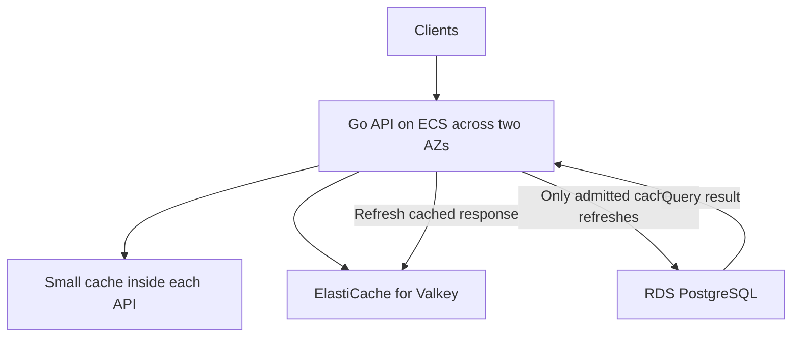

# Challenge 04 · A popular post takes down the database when its cache expires

Your Comments API serves

```
GET /posts/p123/comments?limit=20
```

A post goes viral: 20,000 requests a second, spread over 20 API processes. A load test
says PostgreSQL can safely run 500 of these queries a second. That is fine, because almost
every answer comes from a cache: a reusable copy of the database result.

Then the cached entry for p123 expires. Thousands of requests miss at the same moment,
all of them query PostgreSQL, PostgreSQL slows down, and the slower it gets the more
requests pile up behind it. This is a **cache stampede**.

The product allows public comment lists to be up to two minutes old during an incident.
Creating comments must stay available.

This challenge builds the fix in six parts, each one measured. You can play with every
defence, and switch them on and off, from one page.


## See it

```bash
uv sync --all-packages
uv run stampede            # opens http://127.0.0.1:8091
```

No Postgres, no Docker, no AWS account. It runs on Windows, macOS and Linux.

The page has six scenarios (p123 expires, a long run past the hard TTL, a complete cold
start, an ElastiCache outage, a database outage, autoscaling mid-incident) and a switch for
each defence. Press run and it simulates every request, then replays the run second by
second:

- the fleet, with each API process coloured by what its readers are getting;
- ElastiCache, up or unreachable, and the state of p123's entry;
- PostgreSQL's CPU gauge, queries sent, finished and running;
- the p123 entry itself, with its three timestamps, as the lesson writes it;
- charts of what readers got, database load, the age of the data served, and write latency.

A second card drives **the real code**, not the simulation: 100 threads asking for one
cold post through a real SQLite database, a real `GET /posts/p123/comments?limit=20`, and a
real `POST` that returns the new comment.

## The design



- **PostgreSQL owns the comments.** ElastiCache holds disposable copies.
- **Each API process keeps a bounded local cache** of recently used responses, so a
  temporary ElastiCache outage does not erase every copy at once.
- **The API runs across two Availability Zones** (isolated locations within an AWS
  Region). The database and ElastiCache are reachable only inside the VPC.
- **Node-based ElastiCache runs a primary and a replica in different AZs** with Multi-AZ
  automatic failover. That shortens an interruption, but the application must still handle
  cache errors and missing entries.

The four rules, one part each:

1. **Expire freshness before throwing away the response.** A soft TTL (30 s) says a refresh
   is due; a hard TTL (120 s) says the response is no longer acceptable. In between, serve
   it at once and refresh behind it. Copies keep their timestamps.
2. **Let concurrent requests share one refresh.** In each process,
   `cache key -> refresh in progress`. Twenty processes can still make twenty queries, and
   that is accepted.
3. **Bound database work even when every cache fails.** A separate refresh budget: a rate
   (5 starts a second per process) and a concurrency cap, short query deadlines. Out of
   budget means serve stale or reject, never "send it to PostgreSQL anyway".
4. **Make the trade-off explicit.** Readers may see a list up to two minutes old. A
   successful `POST` returns the new comment so the writer sees it at once. A full cold start
   returns some 503s while the cache warms, on purpose.

## The six parts

| Part | The question | What you'll see |
|---|---|---|
| [1 · The stampede](part-1-the-stampede) | What does a plain 30-second TTL do when p123 expires? | 0% of reads served from then on. PostgreSQL at 100% CPU starts 19,819 queries a second and finishes none in time, and it never recovers. |
| [2 · Jitter is not enough](part-2-jitter-is-not-enough) | Random TTLs are the usual advice. Do they help? | For 10,000 posts cached together, the worst second drops from 8,899 queries to 908. For one hot post, nothing changes: 263 queries either way. |
| [3 · Serve stale, refresh behind](part-3-serve-stale-refresh-behind) | What if an expired response is still served for a while? | Readers get 100% for 90 seconds, but every stale read starts its own refresh and the database still finishes nothing. And a copy that is re-stamped serves 200-second-old data. |
| [4 · One refresh per key](part-4-one-refresh-per-key) | What if concurrent requests share one refresh? | 100% served, 20 queries per refresh (one per process), 4% database CPU. Real threads: 100 callers, 1 read. Real processes: 20 x 100 callers, 20 reads. |
| [5 · A budget for the database](part-5-a-budget-for-the-database) | What about thousands of different posts missing at once? | Coalescing alone: 0% served, forever. With the budget, PostgreSQL stays near 100 queries a second and the cache warms to 84% in 40 s. Double the fleet and a per-process budget doubles too. |
| [6 · Failure drills](part-6-failure-drills) | Lose ElastiCache. Lose the database. What do you measure? | The local cache serves 77% through an ElastiCache outage (0.6% without it). With the database down, the hit rate reads 100% while the data ages to 120 s. |

Each part is a folder with a script, its latest `results.md`, charts drawn from the same
run, a test, and a README that explains the idea from zero.

## How it is built

| Piece | What it does | Code |
|---|---|---|
| Entry and policy | a response with `source_read_at`, `refresh_after`, `discard_after`; fresh, stale or expired by age | [entry.py](../../packages/jiffy-cache/src/jiffy_cache/entry.py) |
| Local cache | bounded, least recently used out; never re-stamps, never lets an older read replace a newer one | [local.py](../../packages/jiffy-cache/src/jiffy_cache/local.py) |
| Coalescing | `SingleFlight`: the first caller for a key runs the query, the rest wait up to their own deadline | [flight.py](../../packages/jiffy-cache/src/jiffy_cache/flight.py) |
| Refresh budget | a token bucket for new refreshes plus a cap on running ones; `for_fleet` divides a fleet budget | [budget.py](../../packages/jiffy-cache/src/jiffy_cache/budget.py) |
| The real API | the read and write paths with those pieces, over a real SQLite file | [real.py](stampede/real.py) |
| The simulator | 20 processes, pools, ElastiCache, an 8-core PostgreSQL, 20,000 requests a second | [sim.py](stampede/sim.py) |
| The scenarios | every scenario named once, used by the parts and the page | [experiments.py](stampede/experiments.py) |
| The Go versions | the lesson's 100-callers program, and per-key coalescing with deadlines | [part-4 go/](part-4-one-refresh-per-key/go) |
| The page | the server and the UI | [api.py](stampede/api.py), [ui/](stampede/ui) |

The cache pieces live in the reusable package [`jiffy-cache`](../../packages/jiffy-cache).

## How the simulation models the fleet

Every number in the simulated parts comes from these assumptions, so they are worth
reading once:

| | Modelled as | Why that is fair |
|---|---|---|
| Clients | 20,000 reads a second, random arrival times, a random API process | a load balancer spreads requests; Poisson arrivals are the textbook model of many independent users |
| A read's deadline | 500 ms, then the client gets a 503 and the query is cancelled | Go cancels a query when its context ends, and PostgreSQL stops it |
| Connection pools | 25 read and 10 write connections per process | 20 processes x 25 = 500 queries can reach the database at once |
| PostgreSQL | 8 cores; a comments query needs 12 ms of CPU; running queries share the cores equally | 8 / 12 ms = 667 queries a second flat out, so 500 is a safe 75% |
| ElastiCache | one dictionary; entries vanish at their hard TTL; it can be unreachable | the application treats an error and a miss the same way |
| Writes | 100 comments a second, 3 ms of CPU each, their own pool | so you can watch what the reads do to them |

The key consequence: once all 500 connections are busy, each 12 ms query takes
500 x 12 ms / 8 = 750 ms. With a 500 ms deadline, no query can ever finish, so the cache is
never refilled. Part 1 measures that boundary.

What is **not** modelled: network latency, client retries (which make a stampede worse),
lock contention and thrashing inside PostgreSQL (which make an overloaded database slower
than "fair sharing"), the seconds an ElastiCache failover takes, and cost. Real numbers will
differ; the shape will not.

## Run it all

```bash
uv run stampede                                                        # the page
uv run challenges/04-cache-stampede/part-1-the-stampede/the_stampede.py   # any one part
uv run pytest challenges/04-cache-stampede packages/jiffy-cache          # the tests
cd challenges/04-cache-stampede/part-4-one-refresh-per-key/go && go run ./cmd/onekey
```

`./verify` runs every part as a gate, along with the rest of the repository.

## What to measure in production

Not just the cache hit rate. Part 6 shows it reading 100% for 95 seconds while every
response gets older. Measure:

- **the oldest data served** (age from `source_read_at`), against the two-minute promise;
- **the database refresh rate**, against the budget;
- **refresh failures**, which mean the cache is living on borrowed time;
- **rejected reads** (the deliberate 503s), which should be near zero outside a cold start.

## The trade-offs, said plainly

- Readers may see a comment list up to two minutes old. The writer sees their own comment
  at once, because the `POST` returns it.
- Do not apply this staleness policy to authorisation decisions or to anything that must
  disappear at once (a removed comment that is illegal, for example). Those need an
  explicit purge or no cache.
- A complete cold start has nothing stale to serve. Some reads get a 503 while the cache
  warms. That is the deliberate alternative to letting the whole database collapse.
- The ElastiCache replica and the local caches cost money and memory. They pay for
  themselves by keeping expensive database demand bounded and the service up while
  something else is failing.

## Further reading

- AWS Builders' Library, [Caching challenges and strategies](https://aws.amazon.com/builders-library/caching-challenges-and-strategies/): soft and hard TTLs, request coalescing, and why a cache can make an outage worse.
- Nishtala et al., [Scaling Memcache at Facebook](https://www.usenix.org/system/files/conference/nsdi13/nsdi13-final170_update.pdf) (NSDI 2013): leases, Facebook's answer to thundering herds and stale sets.
- Bronson et al., [Metastable Failures in Distributed Systems](https://sigops.org/s/conferences/hotos/2021/papers/hotos21-s11-bronson.pdf) (HotOS 2021): why a system stays down after the trigger is gone, which is exactly part 1.
- Vattani et al., [Optimal Probabilistic Cache Stampede Prevention](https://www.vldb.org/pvldb/vol8/p886-vattani.pdf) (VLDB 2015): refreshing early at random, an alternative not built here.
- [RFC 5861](https://www.rfc-editor.org/rfc/rfc5861): `stale-while-revalidate` and `stale-if-error`, the same idea in HTTP.
- Go's [`golang.org/x/sync/singleflight`](https://pkg.go.dev/golang.org/x/sync/singleflight): the standard per-key coalescer. Part 4's `coalesce` package adds a per-caller deadline.

## Layout

```
challenges/04-cache-stampede/
  stampede/                       the simulator, the real API, the page
  part-1-the-stampede/
  part-2-jitter-is-not-enough/
  part-3-serve-stale-refresh-behind/
  part-4-one-refresh-per-key/     with go/: the Go programs and tests
  part-5-a-budget-for-the-database/
  part-6-failure-drills/
  tests/                          the simulator, the real code and the HTTP API
packages/jiffy-cache/             entries, local cache, coalescing, refresh budget
```
