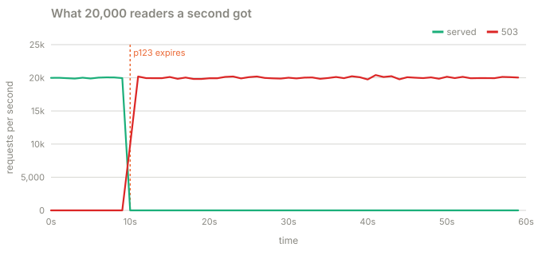
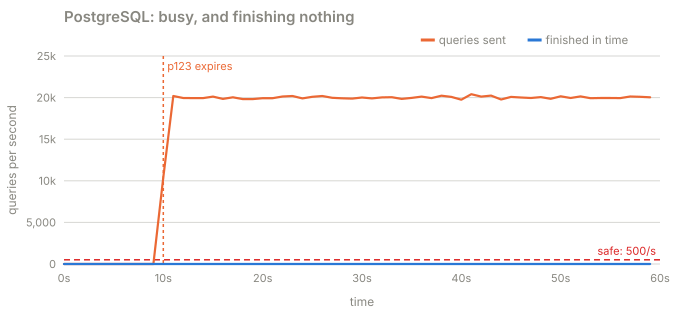

# Part 1 · The stampede

**Question:** p123's comments are cached for 30 seconds. 20,000 people a second are reading
them. What happens at the moment the cached copy expires?

**Answer:** every request misses at once, 20,000 queries a second hit a database that can
safely run 500, and every query slows down so much that none finishes before its deadline.
Because nothing finishes, nothing refills the cache, so it never stops. 0% of reads served,
for as long as the traffic lasts.

## The idea, from zero

A cache is a copy of an answer you already computed. Reading the copy is cheap. Computing
the answer again (a PostgreSQL query) is expensive. With a plain TTL ("time to live"), the
copy is thrown away after 30 seconds and the next reader computes it again.

That works when the next reader is alone. It breaks when 20,000 readers a second arrive
in the same instant after the copy is gone:

1. The entry expires. In the next 10 ms, 200 requests miss. Each one sends a query.
2. All 500 database connections fill within 25 ms. Now 500 queries share 8 CPU cores.
3. A query that needs 12 ms of CPU now gets 8/500 of a core, so it takes 750 ms.
4. The API gives each read 500 ms. Every query is cancelled before it finishes.
5. No query finished, so no copy was written. The next requests miss too. Go to 2.

Step 5 is what turns a spike into an outage. The trigger (one expiry) is over in a moment,
but the system stays down by itself as long as the load stays. This shape has a name: a
**metastable failure**.

## What the part does

| Step | What happens | Code |
|---|---|---|
| 1 | 20 API processes, 20,000 reads a second for p123, its entry warm and due at t = 10 s | [`SCENARIOS["expiry"]`](../stampede/experiments.py#L50) |
| 2 | A read looks in the cache; past the TTL it queries, with a 500 ms deadline | [`read`](../stampede/sim.py#L662), [`_foreground`](../stampede/sim.py#L704) |
| 3 | PostgreSQL shares 8 cores equally between running queries; cancelled ones stop | [`Database`](../stampede/sim.py#L223) |
| 4 | Count, every second: served, 503s, queries sent and finished, CPU, write latency | [`Run.window`](../stampede/sim.py#L476) |
| 5 | Repeat with other deadlines and other traffic levels | [the_stampede.py](the_stampede.py) |

## Results

**A. The expiry** (60 s run):

| | before (0 to 10 s) | after it expires (10 to 60 s) |
|---|---|---|
| reads served | 100.0% | 0.0% |
| 503s per second | 0 | 19,809 |
| queries sent to PostgreSQL per second | 0 | 19,819 |
| queries that finished in time per second | 0 | 0 |
| database CPU busy | 3.7% | 100.0% |
| queries running at once (most) | 4 | 541 |
| comment writes, 99th percentile | 3 ms | 200 ms |

PostgreSQL is at 100% CPU doing work that is thrown away. It starts nearly 20,000 queries a
second (connections are freed fast because each query is cancelled soon after it gets one)
and finishes none. Writes still succeed, but 70 times slower: they share the same CPU.

**B. The deadline decides whether it ever recovers** (30 s runs):

| a read may wait | served after the expiry | back to 99% served after | queries sent | finished in time |
|---|---|---|---|---|
| 500 ms | 0.0% | never | 390,250 | 0 |
| 750 ms | 96.5% | 2 s | 13,910 | 56 |
| 1000 ms | 96.6% | 2 s | 13,910 | 500 |
| 2000 ms | 96.8% | 3 s | 13,910 | 1,000 |

The first queries finish in about 665 ms, a little under the 750 ms worst case. Give a
read that long and one of them lands, refills the cache, and the stampede is over in two
seconds (at the cost of 13,910 queries in a few seconds). Give it 500 ms and none ever lands.

**C. And it only happens above a certain load** (500 ms deadline, 30 s runs):

| reads per second | served after the expiry | back to 99% served after | most queries sent in one second |
|---|---|---|---|
| 1,000 | 100.0% | 0 s | 13 |
| 2,000 | 100.0% | 0 s | 106 |
| 5,000 | 98.0% | 1 s | 2,019 |
| 10,000 | 0.0% | never | 10,167 |
| 20,000 | 0.0% | never | 20,197 |

At 5,000 reads a second the same expiry is a blip. At 10,000 it is an outage. Nothing in the
code changed between those rows, which is why this bug ships: it passes every test that does
not reproduce the real traffic.

## What it means

- **A stampede is not "a lot of load for a moment".** It can be a stable state. The usual
  advice "it will recover once the cache refills" assumes some query finishes.
- **Longer deadlines do not fix it.** They let it recover here, but a slightly bigger spike
  (or client retries) puts you back over the edge, and the database still took 13,910 queries
  in seconds.
- **Writes suffer too,** even with their own connection pool. Pools limit connections, not
  CPU.

The next parts fix it in the lesson's order: jitter (part 2, which does not help this),
serving stale (part 3), coalescing (part 4) and a budget (part 5).

## Try this

- In `uv run stampede`, pick **p123 expires** with every defence off. Watch the fleet turn
  red at t = 10 and PostgreSQL's gauge pin at 100%.
- Move **A read may wait** to 1,000 ms and run again: it recovers. Back to 500 ms, and lower
  **Reads per second** to 5,000: a blip.

## Files

| File | What's in it |
|---|---|
| [the_stampede.py](the_stampede.py) | this part |
| [results.md](results.md) | the latest run |
| [test_the_stampede.py](test_the_stampede.py) | the plain TTL never recovers at 20,000 a second; a 1 s deadline does |
