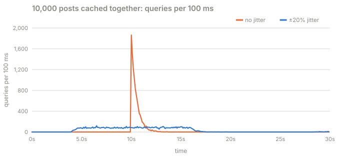
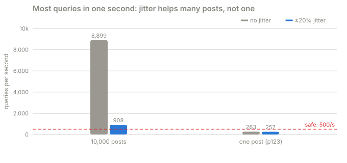

# Part 2 · Jitter is not enough

**Question:** the usual advice for expiring caches is "add jitter": give every entry a
slightly random TTL so they do not all expire together. Does that fix part 1?

**Answer:** no. Jitter spreads **many different entries** over time, and it does that very
well. Part 1 is **one** entry. Its expiry moves a little earlier or later, and the same
thousands of readers still miss it in the same instant.

## The idea, from zero

Picture a deploy or a cache flush. All 10,000 popular posts get cached in the same minute,
each with a 30-second TTL. Thirty seconds later they all expire in the same minute, and the
database gets 10,000 queries at once. That is a stampede across keys, and jitter is made for
it: a TTL of 30 s ± 20% spreads those 10,000 expiries over twelve seconds.

Now picture one post with 20,000 readers a second. Jitter changes *when* it expires, from
t = 10 s to, say, t = 8.3 s. It does not change *how many readers are waiting* when it does.
In the 12 ms the first query takes, 240 requests arrive, and every one of them misses.

## What the part does

| Step | What happens | Code |
|---|---|---|
| 1 | Cache 10,000 posts at the same moment, 20,000 reads a second spread over them | [`demand`](jitter.py#L20) |
| 2 | Count the queries the cache sends, against a database that never slows down, so the count is pure demand | [`worst_second`](jitter.py#L34) |
| 3 | The same with one post, p123 | [jitter.py](jitter.py) |
| 4 | Both again against the real 8-core database | [`SCENARIOS["expiry"]`](../stampede/experiments.py#L50) |
| 5 | Jitter itself: both TTLs scaled by the same random factor | [`Policy.entry`](../../../packages/jiffy-cache/src/jiffy_cache/entry.py#L78) |

## Results

**A. 10,000 posts cached at the same moment**, all due at t = 10 s:

| TTL jitter | queries in total | most in any one second | most in any 100 ms |
|---|---|---|---|
| ±0% | 10,243 | 8,899 | 1,864 |
| ±10% | 10,244 | 1,752 | 206 |
| ±20% | 10,289 | 908 | 119 |

The same number of queries, spread so that the worst second has a tenth of them.

**B. One post, p123, with the same jitter:**

| TTL jitter | queries in total | most in any one second | most in any 100 ms |
|---|---|---|---|
| ±0% | 263 | 263 | 263 |
| ±10% | 227 | 227 | 227 |
| ±20% | 257 | 257 | 257 |

All of them in the first few milliseconds, with or without jitter.

**C. And against the real 8-core database** (every entry has expired by t = 16 s):

| posts | TTL jitter | reads served, 16 to 30 s | back to 99% | database CPU |
|---|---|---|---|---|
| 10,000 posts | ±0% | 0.0% | never | 100.0% |
| 10,000 posts | ±20% | 5.6% | never | 100.0% |
| one post | ±0% | 0.0% | never | 100.0% |
| one post | ±20% | 0.0% | never | 100.0% |

Even the jittered 10,000 posts collapse here: spread over twelve seconds they still ask for
about 850 queries a second, above what this database can do. Jitter lowers the peak; it
does not create capacity.

## What it means

- **Keep jitter.** It is cheap, and it removes a whole class of synchronized expiries.
- **Do not expect it to protect a hot key.** That needs the next two parts: serving stale
  (part 3) and sharing one refresh (part 4).
- **Do not expect it to bound the database either.** That is the budget (part 5).

## Try this

- Change the jitter in [`demand`](jitter.py#L20) to ±50% and rerun: the 10,000-post peak
  falls further, the one-post row does not move.

## Files

| File | What's in it |
|---|---|
| [jitter.py](jitter.py) | this part |
| [results.md](results.md) | the latest run |
| [test_jitter.py](test_jitter.py) | jitter cuts the many-key peak at least five-fold and leaves one key alone |
