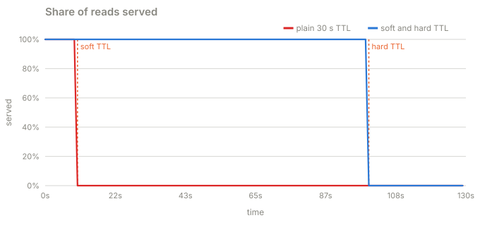
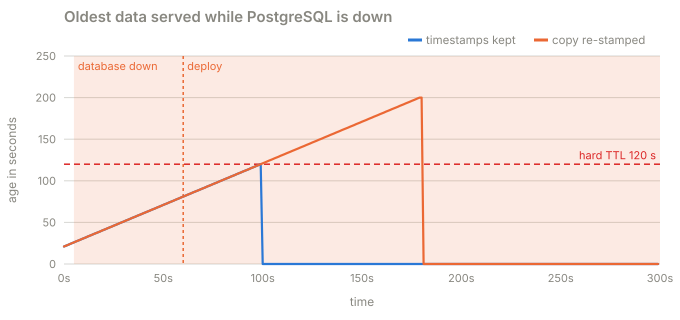

# Part 3 · Serve stale, refresh behind

**Question:** the product says a comment list may be up to two minutes old during an
incident. What if the cache keeps serving an expired list while it fetches a new one?

**Answer:** readers stop noticing the expiry: 100% are served, instantly. But on its own
this only moves the problem. Every stale read starts its own refresh, the database still
drowns, and two minutes later the list becomes too old to serve. It buys time. Part 4 uses
that time.

## The idea, from zero

Instead of deleting a useful response after 30 seconds, store when it was read and two
limits:

```json
{
  "key": "public-comments:p123:limit20",
  "source_read_at": "2026-10-28T08:00:00Z",
  "refresh_after": "2026-10-28T08:00:30Z",
  "discard_after": "2026-10-28T08:02:00Z",
  "comments": [{"id": "c901", "text": "Helpful explanation"}]
}
```

| Entry age | What the API does |
|---|---|
| under 30 seconds | return the cached response |
| 30 to 120 seconds | return it immediately, and try a refresh in the background |
| over 120 seconds, or absent | wait briefly for an admitted refresh, otherwise 503 |

The first limit is a **soft TTL**: a refresh is due. The second is a **hard TTL**: the
response is no longer acceptable.

Two rules make the timestamps honest:

- **Copies keep their timestamps.** When a process copies an entry from ElastiCache into
  its local cache, it copies `source_read_at` too. If it stamped the copy "read just now",
  a stale list would get another two minutes of life every time it moved between caches.
- **The age starts at the read, not the arrival.** A query that takes a second returns data
  that is already a second old. `source_read_at` is when the query *started*.

## What the part does

| Step | What happens | Code |
|---|---|---|
| 1 | An entry is fresh, stale or expired by its age | [`Entry.state`](../../../packages/jiffy-cache/src/jiffy_cache/entry.py#L35) |
| 2 | A new entry gets both limits from the time the read started | [`Policy.entry`](../../../packages/jiffy-cache/src/jiffy_cache/entry.py#L78) |
| 3 | A stale read is served and starts a refresh behind it | [`read`](../stampede/sim.py#L662), [`_background`](../stampede/sim.py#L692) |
| 4 | Copying into the local cache keeps the timestamps (or, for the comparison, does not) | [`read`](../stampede/sim.py#L662), [`LocalCache.put`](../../../packages/jiffy-cache/src/jiffy_cache/local.py#L35) |
| 5 | The real code: the refresh records the time before it queries | [`_refresh`](../stampede/real.py#L198) |

## Results

**A. p123 expires at t = 10 s** (soft TTL 30 s, hard TTL 120 s, so the list may be served
until t = 100 s):



| | served, 10 to 100 s | served after 100 s | oldest served | queries sent per second | finished in time | database CPU |
|---|---|---|---|---|---|---|
| plain 30 s TTL | 0.0% | 0.0% | nothing served | 19,908 | 0 | 100.0% |
| soft and hard TTL | 100.0% | 0.0% | 120 s | 19,908 | 0 | 100.0% |

Readers are fine for exactly 90 seconds. Behind them, every one of the 20,000 stale reads a
second started its own background refresh, PostgreSQL ran at 100% the whole time, and not
one refresh finished. At t = 100 s the list hits its hard TTL and the outage begins anyway.

**B. PostgreSQL is down from t = 5 s, and a deploy restarts every API process at t = 60 s**
(2,000 reads a second, every defence on):



| | last response served at | oldest data served | oldest age the cache believed |
|---|---|---|---|
| timestamps kept on copy | 100 s | 120 s | 120 s |
| copy re-stamped as just read | 181 s | 200 s | 120 s |

The deploy empties every local cache. The processes refill them from ElastiCache. With the
bug, each copy is stamped as read at t = 60 s, so lists that were already 80 seconds old are
served for another two minutes. The cache believed nothing it served was over 120 seconds
old. The real age reached 200.

**C. Age from the read, not from the arrival** (the real code, a one-second query):

| query took | age of the entry the moment it landed |
|---|---|
| 1.0 s | 1.02 s |

## What it means

- **Serving stale turns an expiry into a non-event for readers**, as long as something
  eventually refreshes the entry.
- **"Attempt a background refresh" needs a limit.** Here every stale read attempted one,
  and the attempts were the stampede. Part 4 shares one refresh per key.
- **Timestamps are part of the data.** Any copy (local cache, replica, CDN, a `SET` that
  passes a fresh TTL) must carry the original read time, or the two-minute promise is
  quietly broken.

## Try this

- In `uv run stampede`, pick **p123 expires, long run**, switch on only **1 · Soft and hard
  TTL**: readers are happy until t = 100, while the CPU gauge stays pinned.
- Pick **Database outage**, switch everything on, and untick **Keep timestamps on copy**:
  the oldest-data chart climbs past the 120 s line.

## Files

| File | What's in it |
|---|---|
| [serve_stale.py](serve_stale.py) | this part |
| [results.md](results.md) | the latest run |
| [test_serve_stale.py](test_serve_stale.py) | stale serves everyone until the hard TTL and no longer; a slow read lands already old |
