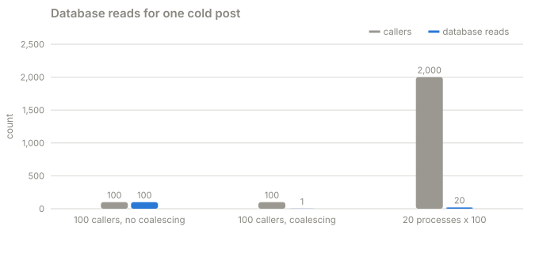

# Part 4 · One refresh per key

**Question:** when p123 needs refreshing and a thousand requests notice at once, how many
of them should query the database?

**Answer:** one per API process. The first request starts the refresh; every other
request either serves the stale copy or waits for that refresh, up to its own deadline.
With 20 processes, that is at most 20 queries per refresh instead of tens of thousands, and
the stampede is gone.

## The idea, from zero

Inside each API process, keep a map:

```
cache key -> the refresh currently in progress
```

When a request needs a refresh and the map already has one for its key:

- if it has an acceptable cached response, it returns it (part 3);
- if not, it waits for the refresh in progress, but only within its own deadline;
- either way, it does not start another database query.

This is **request coalescing** (Go calls it `singleflight`). It has two traps:

- **Coordinate per key, not globally.** One lock for the whole cache means refreshing p123
  blocks p456. The lesson's 100-caller example uses one mutex on purpose, to stay small.
- **Bound the wait.** Waiters must give up at their own deadline, not whenever the
  refresh finishes.

And one deliberate limit: **the map lives in one process.** Twenty processes that miss
together make up to twenty queries. A distributed lock could cut that to one, but it adds
a dependency that can fail on exactly the bad day, to save nineteen reads. Not worth it here.

## What the part does

| Step | What happens | Code |
|---|---|---|
| 1 | The leader runs the query; later callers wait on its result, each with its own timeout | [`SingleFlight.do`](../../../packages/jiffy-cache/src/jiffy_cache/flight.py#L43) |
| 2 | The real API uses it for misses and for refreshes behind stale reads | [`_fetch`](../stampede/real.py#L214), [`_refresh_behind`](../stampede/real.py#L219) |
| 3 | The simulated fleet does the same, per process | [`_background`](../stampede/sim.py#L692), [`_foreground`](../stampede/sim.py#L704) |
| 4 | Real threads in one process, then 20 real OS processes, at one cold post | [`real_burst`](../stampede/experiments.py#L134) |
| 5 | A slow key next to a fast one; waiters against a 2-second query | [`real_two_keys`](../stampede/experiments.py#L161), [`real_waiters`](../stampede/experiments.py#L196) |
| 6 | The same in Go | [go/coalesce](go/coalesce/coalesce.go), [go/cmd/onekey](go/cmd/onekey/main.go), [go/cmd/fleet](go/cmd/fleet/main.go) |

## Results

**A. The fleet**: soft and hard TTL plus one refresh per key per process, 20,000 reads a
second, p123 turning stale at t = 10 s and again at t = 40 s (60 s run):

| | 10 to 60 s |
|---|---|
| reads served | 100.0% |
| oldest data served | 30.0 s |
| queries sent to PostgreSQL | 40 |
| queries that finished in time | 40 |
| most database CPU in one second | 7.8% |
| comment writes, 99th percentile | 8 ms |

Compare part 3: 19,908 queries a second, none finished, 100% CPU. Here: 40 queries in 50
seconds, all finished.

**B. How many queries one refresh of p123 costs:**

| API processes | queries on a cold start | reads served on a cold start | queries when it turns stale |
|---|---|---|---|
| 1 | 1 | 100.0% | 1 |
| 5 | 5 | 100.0% | 5 |
| 20 | 20 | 100.0% | 20 |
| 40 | 40 | 100.0% | 40 |

Exactly one per process. Even a cold start (nothing to serve stale) is fully served: readers
wait about 30 ms for their process's single query.

**C. The real code**: threads, real time, a real SQLite file, a 200 ms query:



| processes | callers each | coalescing | reads served | database reads |
|---|---|---|---|---|
| 1 | 100 | off | 100 | 100 |
| 1 | 100 | on | 100 | 1 |
| 20 | 100 | on | 2,000 | 20 |

| check | result |
|---|---|
| p456 asked while p123's 500 ms refresh runs | answered in 81 ms |
| 100 callers, a 2 s query, 500 ms deadline | 99 gave up, the slowest after 517 ms; 1 database read |

The 20-process row uses 20 real OS processes with nothing shared between them but the
database file: each one coalesces its own 100 callers, and the database sees 20 reads.
That is the boundary the lesson describes.

**D. The Go versions:**

```
$ go run ./cmd/onekey
requests: 100, database reads: 1
$ go run ./cmd/fleet
processes: 20, requests: 2000, keys: 2, database reads: 40, shared results: 1960, took: 203ms
```

`onekey` is the lesson's program unchanged: one mutex, one key, no expiry. `fleet` uses
[`coalesce.Group`](go/coalesce/coalesce.go), which is per key and lets each waiter leave at
its own context deadline: 20 processes x 100 callers over two keys make 40 reads (20 per
key), and the two keys refresh side by side in 203 ms rather than one after the other.

## What it means

- **This is the fix for the hot key.** Stale serving (part 3) keeps readers happy; one
  refresh per key keeps the database out of it.
- **The cost is bounded by the fleet, not by the traffic.** 20,000 or 200,000 reads a
  second, a refresh still costs 20 queries.
- **It does not help thousands of *different* keys missing together**: each key gets its
  own refresh. That is part 5.

## Try this

- In `uv run stampede`, press **1 + 2** under quick picks: 100% served, a flat database.
- In **The real code** card, press both burst buttons: 100 reads, then 1.
- `cd go && go test -race ./...` runs the Go tests, including a waiter that leaves at its
  own deadline.

## Files

| File | What's in it |
|---|---|
| [one_refresh_per_key.py](one_refresh_per_key.py) | this part |
| [results.md](results.md) | the latest run |
| [test_one_refresh_per_key.py](test_one_refresh_per_key.py) | one query per process; the real code reads once; the Go tests pass |
| [go/](go) | the Go programs and the `coalesce` package with its tests |
