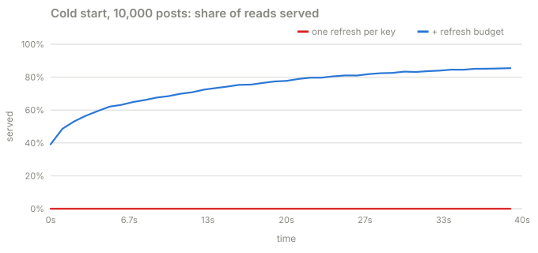
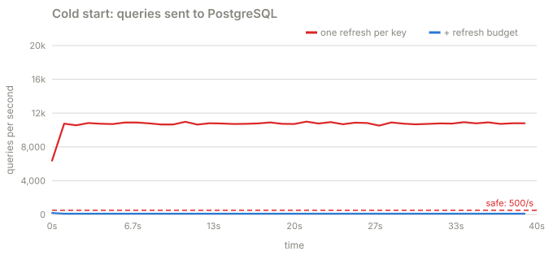
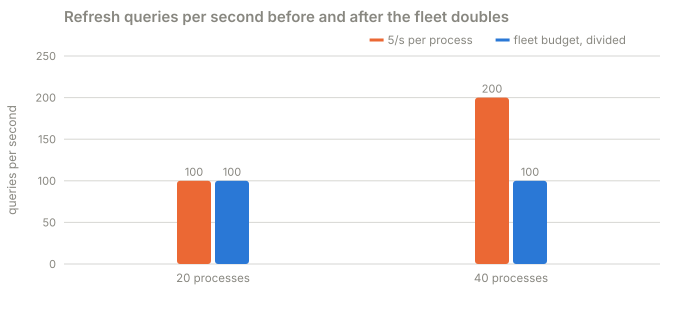

# Part 5 · A budget for the database

**Question:** coalescing gives one refresh per key. What happens when 10,000 *different*
posts are missing at the same time: a deploy, a flushed cache, an ElastiCache outage?

**Answer:** coalescing cannot help: 10,000 keys means 10,000 refreshes per process, and the
database collapses exactly as in part 1. The fix is a separate budget for cache refreshes,
per process: so many new refreshes a second, so many running at once, each with a short
deadline. Out of budget means "serve stale or reject", never "query anyway".

## The idea, from zero

Give cache refreshes their own allowance, separate from everything else the database does.
For a fixed fleet of 20 processes, an illustrative budget is:

```
5 refresh starts a second, per process  x  20 processes  =  100 refresh queries a second
```

Two limits, because they bound different things:

- **A rate limit bounds new work.** A token bucket: 5 tokens a second, a refresh takes one.
- **A concurrency limit bounds work already running.** At most 2 refreshes in flight per
  process, each with a 300 ms execution deadline.

When the budget says no, the request serves an acceptable stale response if there is one,
and otherwise gets a 503 at once. It never sends the query anyway.

Two more rules:

- **Keep writes on their own bounded connection pool**, so reads cannot take every
  connection. That does not isolate CPU or storage, so load-test reads and writes together.
- **The budget is per process, so it must follow the fleet.** Double the processes and
  "5 a second each" doubles the database load.

## What the part does

| Step | What happens | Code |
|---|---|---|
| 1 | A token bucket plus a running cap; `try_start` never waits | [`RefreshBudget.try_start`](../../../packages/jiffy-cache/src/jiffy_cache/budget.py#L68) |
| 2 | A fleet budget divided by the number of processes, resized when it changes | [`for_fleet`](../../../packages/jiffy-cache/src/jiffy_cache/budget.py#L45), [`resize`](../../../packages/jiffy-cache/src/jiffy_cache/budget.py#L55) |
| 3 | A miss with no budget is rejected at once; a stale read with no budget is served without a refresh | [`_foreground`](../stampede/sim.py#L704), [`_background`](../stampede/sim.py#L692) |
| 4 | Every cache empty, 10,000 posts with a few far more popular than the rest | [`SCENARIOS["cold-start"]`](../stampede/experiments.py#L65) |
| 5 | The fleet doubles at t = 10 s, with a fixed or a divided budget | [`SCENARIOS["autoscale"]`](../stampede/experiments.py#L93), [`scale`](../stampede/sim.py#L559) |

## Results

**A. A complete cold start**: 10,000 posts, every cache empty, 20,000 reads a second
(40 s runs):



| | reads served, each 10 s | queries sent per second | most in one second | finished in time | database CPU | writes, 99th percentile |
|---|---|---|---|---|---|---|
| one refresh per key | 0.0% / 0.0% / 0.0% / 0.0% | 10,666 | 10,995 | 0 | 100.0% | 199 ms |
| + refresh budget | 58.1% / 73.4% / 80.5% / 84.4% | 102 | 180 | 4,080 | 19.0% | 16 ms |



Without the budget, nothing is ever served. With it, PostgreSQL never goes above 180 queries in
a second (the first second includes each process's initial burst of 5), 4,080 queries
finish, and every finished query fills ElastiCache for all 20 processes. The most popular
posts are cached first, so the share served climbs fast and keeps climbing. The price is
explicit: the reads with no copy and no budget got an immediate 503.

**B. The fleet doubles from 20 to 40 processes** at t = 10 s, mid cold start:



| refresh budget | queries per second, 20 processes | queries per second, 40 processes | database CPU after |
|---|---|---|---|
| 5/s per process, fixed | 100 | 200 | 33.7% |
| 100/s for the fleet, divided | 100 | 100 | 18.8% |

The "100 queries a second" limit was never a limit. It was 5 times however many processes
happened to be running.

## What it means

- **Coalescing protects a key. A budget protects the database.** You want both.
- **Rejecting is a feature.** A fast 503 during a cold start costs a retry. An unbounded
  refresh costs every reader, every writer, and possibly the database.
- **Set the budget for the fleet and divide it.** Recompute it when autoscaling changes the
  count, or derive it from the count at startup.
- **Separate pools are not separate databases.** Writes stayed fast here because the budget
  kept CPU low, not because they had their own pool: in part 1 they had their own pool too,
  and their p99 went from 3 ms to 200 ms.

## Try this

- In `uv run stampede`, pick **Complete cold start**, press **1 + 2**, then switch on
  **3 · Refresh budget**: from 0% to a steady climb.
- Pick **Autoscaling during a cold start** with all defences on, then tick **Divide the
  budget by the fleet** and compare the database chart after t = 10.

## Files

| File | What's in it |
|---|---|
| [refresh_budget.py](refresh_budget.py) | this part |
| [results.md](results.md) | the latest run |
| [test_refresh_budget.py](test_refresh_budget.py) | a cold start collapses without a budget and warms with one; the budget must follow the fleet |
