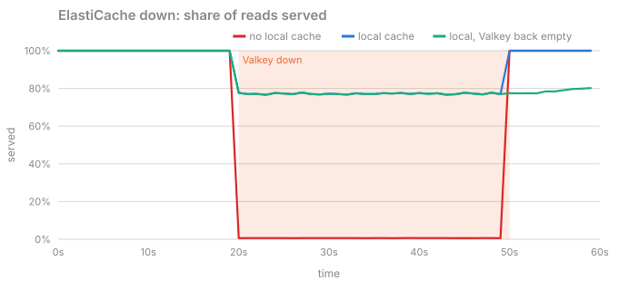
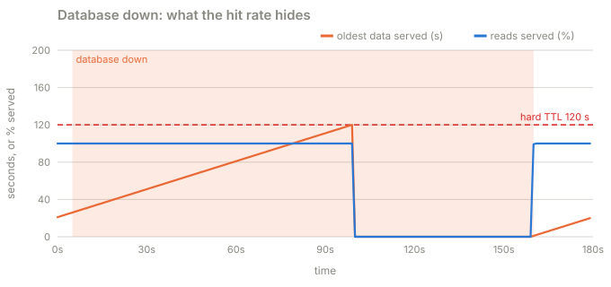

# Part 6 · Failure drills

**Question:** with every defence in place, what happens when ElastiCache becomes
unreachable? When PostgreSQL does? And how would you even know from your dashboards?

**Answer:** the local cache in each process keeps 77% of reads served through an
ElastiCache outage (0.6% without it). A database outage is survivable for exactly the hard
TTL, two minutes, and then reads fail. The dangerous part is that the cache hit rate reads
100% the whole time: only the **age of the data served** shows what is happening.

## The idea, from zero

**ElastiCache down.** Every read misses the shared cache. Without a local copy, every read
needs a refresh, the budget allows 100 a second, and since there is nowhere shared to put
the result, nearly every request is rejected. With a bounded local cache (2,000 entries per
process here), the popular posts are still in memory in every process, at their real age.

Multi-AZ failover shortens an ElastiCache interruption. It does not remove it, so the
application has to treat "cache error" like "cache miss" and lean on its other copies.

**PostgreSQL down.** Every refresh fails. Stale serving keeps the list available until its
hard TTL, then the honest answer is a 503. A hit rate dashboard calls those first 95 seconds
perfect, while the comments being served get older every second.

What to measure instead:

- the **oldest data served**, against the two-minute promise;
- the **database refresh rate**, against the budget;
- **refresh failures**;
- **rejected reads**.

## What the part does

| Step | What happens | Code |
|---|---|---|
| 1 | 10,000 posts, warm caches; ElastiCache unreachable from t = 20 s to t = 50 s | [`SCENARIOS["valkey-outage"]`](../stampede/experiments.py#L72) |
| 2 | The same with and without the local cache, and with ElastiCache coming back empty | [failure_drills.py](failure_drills.py) |
| 3 | A read checks the local cache, then ElastiCache, and copies with timestamps | [`read`](../stampede/sim.py#L662) |
| 4 | PostgreSQL unreachable from t = 5 s to t = 160 s, 2,000 reads a second for p123 | [`SCENARIOS["db-outage"]`](../stampede/experiments.py#L85) |
| 5 | Every 20 seconds: hit rate, oldest data, refresh failures, rejected reads | [`Run.window`](../stampede/sim.py#L476) |

## Results

**A. ElastiCache is unreachable** from t = 20 s to t = 50 s (10,000 posts, warm):

| | served while Valkey is down | of those, from the local cache | queries per second | served in the 10 s after |
|---|---|---|---|---|
| no local cache | 0.61% | 0.0% | 100 | 100.0% |
| local cache, 2,000 entries | 77.2% | 99.7% | 100 | 100.0% |
| local cache, Valkey comes back empty | 77.2% | 99.7% | 100 | 78.6% |

The database load is the same in all three rows: the budget held at 100 queries a second.
What changes is how many readers had a copy to be served from.

**B. PostgreSQL is down** from t = 5 s to t = 160 s (p123, 2,000 reads a second):

| window | cache hit rate | oldest data served | refresh attempts failed or refused | reads rejected |
|---|---|---|---|---|
| 0 to 20 s | 100.0% | 40 s | 19,458 | 0 |
| 20 to 40 s | 100.0% | 60 s | 38,841 | 0 |
| 40 to 60 s | 100.0% | 80 s | 38,884 | 0 |
| 60 to 80 s | 100.0% | 100 s | 38,992 | 0 |
| 80 to 100 s | 100.0% | 120 s | 38,890 | 0 |
| 100 to 120 s | 0.0% | 0 s | 39,151 | 40,138 |
| 120 to 140 s | 0.0% | 0 s | 38,800 | 39,783 |
| 140 to 160 s | 0.0% | 0 s | 38,978 | 39,991 |
| 160 to 180 s | 99.9% | 20 s | 15 | 15 |

Read the hit rate column alone and nothing is wrong until t = 100 s. Read the age column and
the incident is visible from the first minute: 40, 60, 80, 100 seconds old. Refresh
failures say why. (They are high because every stale read asks for a refresh and the budget
or the dead database says no. Each one is cheap; none reaches PostgreSQL.)

When the database comes back at t = 160 s, the first refresh refills the cache and reads
recover at once.

## What it means

- **The local cache is what survives a shared-cache outage.** It is small and bounded, and
  it only needs to hold the popular entries.
- **"Comes back empty" is a different drill from "comes back".** After a node replacement,
  ElastiCache is cold, and the budget decides how fast it warms.
- **Alert on age and on refresh failures, not on hit rate.** A cache that serves old data
  perfectly is still a cache that is failing.
- **The two-minute promise is also a deadline.** A database outage longer than the hard TTL
  becomes a reader-facing outage. Raising the hard TTL buys time and serves older data:
  that is a product decision, not an infrastructure one.

## Try this

- In `uv run stampede`, pick **ElastiCache outage** with **all** defences, then switch off
  **Local cache in each API**.
- Pick **Database outage** with all defences, and drag the time slider from 5 to 100 s:
  the fleet stays amber (stale) while the p123 entry's age bar crosses towards 120.

## Files

| File | What's in it |
|---|---|
| [failure_drills.py](failure_drills.py) | this part |
| [results.md](results.md) | the latest run |
| [test_failure_drills.py](test_failure_drills.py) | the local cache rides out the outage; the hit rate hides the age |
